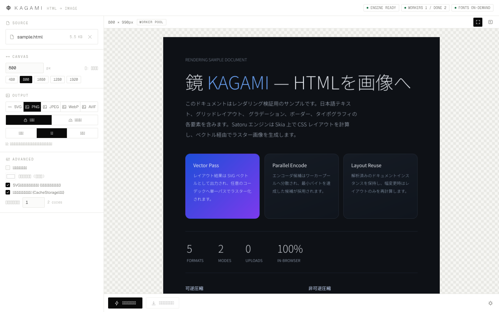
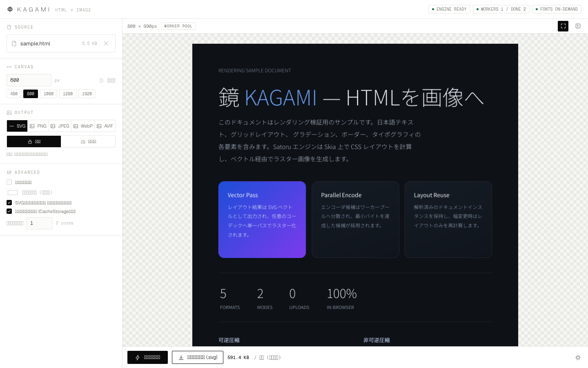
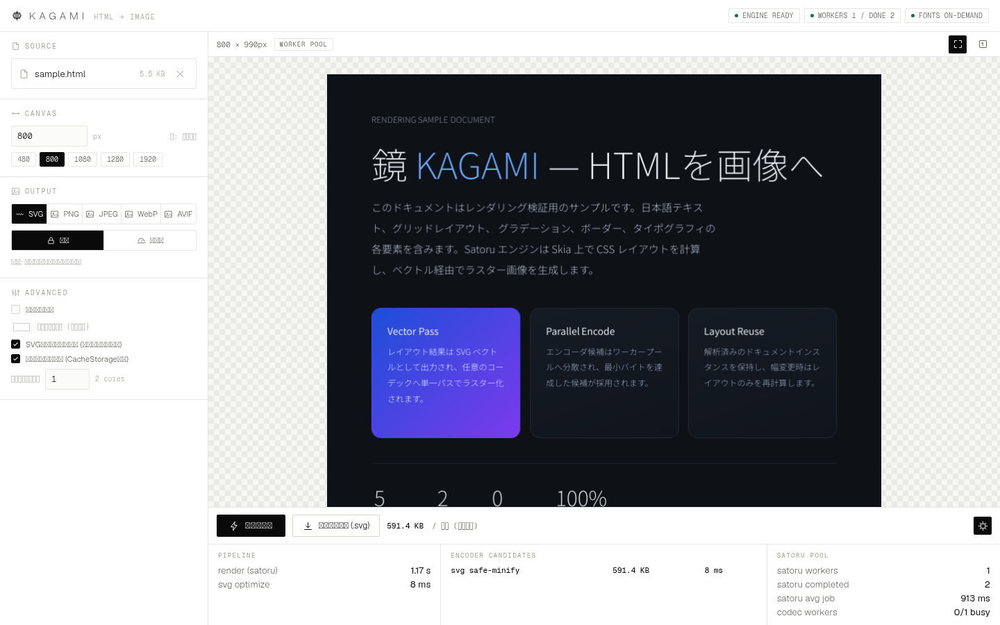

# KAGAMI

**HTML を、そのまま画像に。** — ブラウザ完結型の HTML → 画像コンバータ。
レンダリングエンジンに **Satoru**(Skia / litehtml ベースの WebAssembly エンジン)、コーデックに **jSquash**(Squoosh 由来の WASM コーデック群)を採用。ファイルは端末の外へ一切送信されません。



|                      |                                                                  |
| -------------------- | ---------------------------------------------------------------- |
| 出力形式             | SVG / PNG / JPEG / WebP / AVIF                                   |
| 圧縮モード           | 可逆(ピクセル完全一致を検証)/ 非可逆(品質 % スライダー)          |
| キャンバス           | 横幅 px のみ指定・縦は内容全文の高さを自動検出                   |
| 実行環境             | モダンブラウザ(Chrome / Edge 等)。サーバー不要・アップロード不要 |
| パッケージマネージャ | pnpm                                                             |

---

## 特徴

### 1. Satoru による高精度レンダリング

- Skia + litehtml で CSS レイアウトを WASM 内で計算。Flex / Grid / グラデーション / 論理プロパティ / コンテナクエリなどモダン CSS を再現。
- **マルチスレッドレンダリング**: Satoru ワーカーを 1 ワーカー × N プールで least-busy ディスパッチ。SVG ベクトルパスと Skia ラスターパスの 2 ジョブを同時実行します。
- **レイアウトの再利用**: 解析済みドキュメントインスタンスを保持し、幅変更時は `layout_document`(再レイアウトのみ)、形式・背景・クロップ変更時は `render_from_state`(レイアウト조차不要)を実行。UI には経路(`WORKER POOL` / `LAYOUT REUSE`)を表示します。
- **キャッシュ階層**: SVG 結果 LRU / CacheStorage(外部リソース)/ IndexedDB + メモリ(フォントサブセット)。

### 2. jSquash による極限圧縮

- **可逆**: エンコード後に必ずデコードして元ピクセルと突合し、**完全一致が検証できた場合のみ** `LOSSLESS VERIFIED` として報告。コストを厭わない最大圧縮設定(oxipng level 6 / libwebp lossless method 6 exact / libavif lossless speed 0 等)を採用。
- **非可逆**: 品質スライダー(%)の値を**そのまま**エンコーダ品質へ渡しつつ、Trellis 探索・複数パス・代替量子化テーブル・sharp YUV などの**候補行列をコーデックワーカー間で並列エンコード**し、同一品質での最小バイトを自動採用。
- 形式ごとの正直な制約表示: JPEG は DCT ベースのため数学的可逆モードを持たず(UI に明記し非可逆のみ有効)、PNG の非可逆は一律量子化前処理として実装。

### 3. フォント解決(ネットワーク不要)

Satoru(Skia)はシステムフォントを持たないため、Noto Sans JP Variable を unicode-range で 124 分割したサブセットを同梱し、**ドキュメントが実際に必要とするコードポイントをカバーするサブセットだけ**を読み込みます(メモリ + IndexedDB キャッシュ)。総量約 5.5 MB を同梱しつつ、典型文書では数サブセット(約 100–300 KB)のみでレンダリングできます。

### 4. 極限フラットな UI

- フォントは **Geist**(Variable)。ウェイト 100–300 の極細〜細字を中心に構成。
- 絵文字は使わず、すべての記号はストローク 1.5 のインライン SVG アイコン。
- シャドウ・グラデーション(UI 側)ゼロのヘアラインデザイン。テレメトリドロワーからパイプライン時間・候補ごとのサイズ・ワーカー統計を確認可能。

---

## 必要環境

| ツール   | バージョン                                                           |
| -------- | -------------------------------------------------------------------- |
| Node.js  | >=20.19.0(開発・検証は **v26.12.0 LTS** で実施)                      |
| pnpm     | 12.11.2(`packageManager` フィールドで固定)                           |
| ブラウザ | WebAssembly + Web Workers + OffscreenCanvas 対応(Chrome / Edge 推奨) |

## セットアップ

```bash
corepack enable          # pnpm を有効化 (packageManager フィールドに従います)
pnpm install             # 依存関係のインストール
pnpm run setup           # 静的アセット生成 (フォントサブセット索引など → public/)
pnpm run dev             # 開発サーバー http://localhost:5199
```

## ビルドと配信

```bash
pnpm run build           # 静的ビルド → dist/ (任意の静的ホスティングへ配信可能)
pnpm run preview         # dist/ をローカル配信
```

## スクリプト一覧

| コマンド                           | 内容                                                               |
| ---------------------------------- | ------------------------------------------------------------------ |
| `pnpm run setup`                   | 静的アセット生成(フォントサブセット・索引)                         |
| `pnpm run dev`                     | Vite 開発サーバー                                                  |
| `pnpm run build`                   | 本番ビルド                                                         |
| `pnpm run preview`                 | ビルドのローカル配信                                               |
| `pnpm run test`                    | 下記 2 つの検証を連続実行                                          |
| `pnpm run test:node`               | ヘッドレスパイプライン検証(Node・DOM 不要)                         |
| `pnpm run test:e2e`                | 実 Chromium による E2E 検証(UI 操作・ダウンロード・マジックバイト) |
| `pnpm run lint` / `lint:check`     | ESLint(flat config)+ typescript-eslint                             |
| `pnpm run format` / `format:check` | Prettier                                                           |

## 使い方

1. **SOURCE** に `.html` をドロップ(またはクリック)。即座にプレビューが表示されます。
2. **CANVAS** で横幅(px)を指定。縦は全文自動。
3. **OUTPUT** で形式と圧縮モードを選択。非可逆では品質スライダー、努力量(標準/高/極限)を選択。
4. **エンコード** → サイズ・検証結果・PSNR・所要時間を確認して **ダウンロード**。




## アーキテクチャ

```
                ┌──────────────────────────── main thread ────────────────────────────┐
 HTML file ──▶ │ FontKit: unicode-range subset 選択 / IndexedDB + memory cache        │
                │ RenderEngine                                                        │
                │   ├─ SatoruPool: satoru worker ×N (least-busy dispatch)              │
                │   │     job A: SVG vector pass   job B: Skia raster pass  (並列)     │
                │   ├─ Live document instance (レイアウト再利用)                       │
                │   │     init_document → layout_document(幅変更時)                    │
                │   │     → render_from_state(形式/背景/クロップ変更時)                 │
                │   └─ caches: SVG result LRU / CacheStorage / font subsets            │
                │ CodecPool: codec worker ×N (jSquash WASM)                           │
                │     候補行列を並列エンコード → 最小バイト採用 → decode 検証            │
                └──────────────────────────────────────────────────────────────────────┘
```

### ディレクトリ構成

```
index.html              UI マークアップ
src/main.ts             状態管理と UI ワイヤリング
src/styles.css          デザインシステム (flat / hairline / Geist 100-300)
src/engine/render.ts    Satoru オーケストレーション (プール / 再利用 / キャッシュ)
src/engine/fontkit.ts   フォントサブセット解決
src/codec/strategies.ts 候補行列 (形式 × モード × 努力量)
src/codec/codec-worker.ts  jSquash ワーカー (ラスター / エンコード / 検証)
src/codec/pool.ts       コーデックワーカープール
src/codec/svg.ts        SVG 可逆ミニファイ / 非可逆精度丸め
src/ui/icons.ts         インライン SVG アイコンセット
scripts/setup-assets.mjs  静的アセット生成
tests/node-engine.mjs   ヘッドレス検証
tests/e2e.mjs           Chromium E2E 検証
assets/sample.html      検証用サンプルドキュメント
docs/screenshots/       UI スクリーンショット
REPORT.md               動作検証レポート (実測値)
```

## デプロイ: Cloudflare

KAGAMI は**完全クライアントサイド**で動作するため、Cloudflare では静的サイトとしてホストします(Workers / COOP・COEP は不要)。

### A. ダッシュボード(Git 統合)— 推奨

1. GitHub リポジトリ(本リポジトリ)を Cloudflare に接続:
   **Cloudflare Dashboard → Workers & Pages → Create application → Pages → Connect to Git** → `rikunarita/kagami` を選択。
2. ビルド設定:

   | 項目                   | 値                                                                                                              |
   | ---------------------- | --------------------------------------------------------------------------------------------------------------- |
   | Framework preset       | `None`                                                                                                          |
   | Build command          | `pnpm run setup && pnpm run build`                                                                              |
   | Build output directory | `dist`                                                                                                          |
   | Environment variable   | `NODE_VERSION=26.12.0`(Vite 8 は Node >=20.19 必須。プラットフォーム側で 26 が選べない場合は利用可能な >=22.12) |
   - pnpm は `packageManager` フィールドを検知して Cloudflare 側(corepack)が自動有効化します。
   - **`pnpm run setup`(フォントアセット生成)は build より前に必ず実行する必要**があるため、ビルドコマンドに含めています。

3. **Save and Deploy**。初回ビルド後 `https://<project>.pages.dev` で公開。
4. 検証: `curl -sI https://<project>.pages.dev/` で 200 と MIME を確認(`.wasm` は `application/wasm` で配信されます)。
5. カスタムドメインは Pages プロジェクトの **Custom domains** から。

補足: 大きめのアセット(Satoru ワーカー約 10 MB / Skia WASM 約 7.6 MB)は Pages のファイルあたり上限(25 MiB)内であり、エッジに不変キャッシュされます。

### B. Wrangler CLI(直接デプロイ)

```bash
pnpm install && pnpm run setup && pnpm run build
pnpm exec wrangler login                 # 初回のみ
pnpm exec wrangler pages project create kagami   # 初回のみ
pnpm exec wrangler pages deploy dist --project-name=kagami
```

### C. (応用)エッジでのサーバーサイド生成

`satoru-render` は `workerd` エントリポイントを提供するため、Cloudflare Workers 上での OGP 画像生成も可能です。本リポジトリはプライバシー方針(アップロード不要)によりブラウザ完結構成を採用しています。

## 動作検証

`REPORT.md` に実測値をまとめています(要約):

- **可逆**: PNG / WebP / AVIF のすべてでデコード突合による**ピクセル完全一致**を検証。
- **非可逆**: 同一品質 q85 で AVIF 33.1 KB (PSNR 42.2 dB) / WebP 38.9 KB (40.5 dB) / JPEG 56.6 KB (37.0 dB)。候補並列評価により単一候補より最小の出力を採用。
- **並列レンダリング**: ワーカー 2 で SVG+Skia の 2 ジョブを同時実行、幅変更はレイアウト再利用パス(約 0.4 s)。
- **E2E**: 実 Chromium で 7 シナリオのダウンロード文件的検証・コンソールエラー 0 件。

## 既知の制限

- JPEG に数学的可逆モードは存在しません(UI で明示)。
- AVIF 可逆の speed 0(極限)は大画面で数十秒を要します。努力量「標準」では speed 4 に緩和。
- 低メモリ環境(1 GB 程度)ではワーカー数 2 前後を推奨(`?workers=N` または設定欄で変更可)。

## 開発

```bash
pnpm run lint:check      # ESLint (flat config / typescript-eslint)
pnpm run format:check    # Prettier
```

コードスタイルは Prettier(`.prettierrc.json`)、静的解析は ESLint(`eslint.config.js`)で統一しています。

## ライセンス

- 本リポジトリのコード: **MIT License** (Copyright (c) 2026 rikunarita) — [LICENSE](LICENSE) を参照
- [Satoru (satoru-render)](https://github.com/SoraKumo001/satoru): MIT
- [jSquash](https://github.com/jamsinclair/jSquash) (@jsquash/jpeg, png, oxipng, webp, avif): Apache-2.0 / MIT
- [Geist](https://github.com/vercel/geist-font): SIL Open Font License 1.1
- [Noto Sans JP](https://fonts.google.com/noto/specimen/Noto+Sans+JP): SIL Open Font License 1.1
